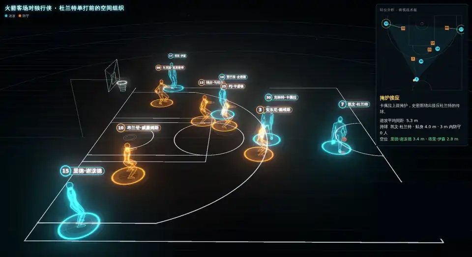

<div align="center">

<p></p>

<p>
<a href="LICENSE"></a>


<a href="https://github.com/jj-cheng25/AgentDunker2026/stargazers"></a>
</p>

**给一段 NBA 转播进攻片段，全自动生成带激情中文解说的「十人全息 3D 战术复盘」短片。**

[English](README_en.md) · [快速开始](#快速开始) · [工作原理](#工作原理) · [基准成绩](#基准成绩) · [性能](docs/performance.md) · [架构文档](docs/architecture.md) · [数据合同](docs/contracts.md) · [配置](docs/configuration.md)

</div>

<!-- DEMO-START -->
https://github.com/user-attachments/assets/daae0661-46ec-4bcc-ac1b-9dedd5bc3615

<p align="center">▶ <b><a href="https://github.com/jj-cheng25/AgentDunker2026/releases/tag/demo-durant">观看完整 1080p 成片（GitHub Release：demo-durant）</a></b></p>
<!-- DEMO-END -->

## 亮点



**无人工干预**：检测并跟踪十名球员和裁判、标定球场、读号码认人、找出手和球路、按战术阶段渲染 3D 复盘、写解说稿并配音、剪辑成片。任何一环不确定都降级展示（少画铭牌、不显示 xFG、跳过 3D……），`report.json` 逐项写明每个元素的档位（A 完整 / B 降级 / C 省略）和原因。

## 全息战术复盘



<p align="center"><sub>演示成片中的 3D 战术复盘段落：十人全息、战术阶段说明、俯视战术板和逐句字幕（转播画中画已遮去，仓库不含任何 NBA 录像）</sub></p>

## 快速开始

```bash
git clone https://github.com/jj-cheng25/AgentDunker2026 && cd AgentDunker2026
python3 -m venv .venv && source .venv/bin/activate
pip install torch torchvision --index-url https://download.pytorch.org/whl/cpu   # 只用 CPU 时；有 GPU 跳过这一行
pip install -e .                      # 一套环境；可选 .[ui] .[gpu] .[dev]
agentdunker download-models           # 约 2.2 GB 权重（sha256 校验）+ Chromium
agentdunker doctor                    # 逐项检查
agentdunker run clip.mp4 -o out/      # → out/film.mp4 + out/report.json
```

需要系统里有 `ffmpeg`（≥ 6，含 libx264）。国内网络可 `export HF_ENDPOINT=https://hf-mirror.com` 后再下载权重。

<table>
<tr><th align="left">命令</th><th align="left">作用</th></tr>
<tr><td><code>agentdunker run CLIP -o OUT [--preset fast|quality] [--threads N]</code></td><td>出片；显示每一步进度和耗时；中断后重跑会复用 <code>OUT/work/</code> 里的缓存</td></tr>
<tr><td><code>agentdunker doctor [--verify] [--ping]</code></td><td>检查 Python 包、ffmpeg、Chromium、权重、API key、官方数据；<code>--verify</code> 校验权重 sha256，<code>--ping</code> 确认 API key 可用（免费）</td></tr>
<tr><td><code>agentdunker download-models</code></td><td>下载全部权重、字体、CLIP、Chromium，带来源 URL、sha256 和许可证</td></tr>
<tr><td><code>agentdunker ui</code></td><td>本地网页：上传片段、看进度、预览和下载成片（需 <code>pip install -e '.[ui]'</code>）</td></tr>
</table>

Python 调用：`from agentdunker import make_film; make_film("clip.mp4", "out/")`。

<details>
<summary><b>模型服务（可选）</b>：Mosshub · MOSS · OpenAI 兼容接口 · Gemini · 完全离线</summary>

<br>

默认走 Mosshub（gemini-3.8-flash、gpt-6-astra）和 MOSS（TTS/ASR 的 Mossland 解说音色、MOSS-VL）：

```bash
export MOSSHUB_API_KEY=...   # 号码读取、角色裁决、解说稿、阶段标题
export MOSS_API_KEY=...      # 解说配音 + 回读校验、MOSS-VL 小判断
```

也支持 OpenAI 兼容接口（含 vLLM / Ollama 等本地服务）和 Google Gemini 官方接口：`agentdunker run clip.mp4 -o out/ --provider openai`，详见 [docs/configuration.md](docs/configuration.md)。`--offline` 完全不调用任何模型服务：解说改为模板字幕，依赖 VLM 的步骤改用本地规则。

</details>

## 工作原理



几何交给专用模型，VLM 只做“小而准”的判断（读号码、读记分牌、选择题式核对）。各阶段之间只通过 [数据合同](docs/contracts.md) 里的 JSON 交换，球场坐标统一用英尺、原点在中圈。解说先行：台词定下来后，3D 复盘按台词节奏渲染。默认在一个进程里依次调用各阶段；`--isolate` 让每个阶段在独立子进程里运行。详见 [架构文档](docs/architecture.md)。

## 基准成绩



<details>
<summary>完整数字</summary>

<br>

| 模块 | 指标 | 结果 |
|---|---|---|
| tracking | 球员召回 / 精度 / IDF1 / 分队准确率（14 段均值） | 0.920 / 0.98 / 0.847 / 0.978 |
| court | 关键点重投影误差 中位 / 90 分位（9 段 169 点）；有效帧比例 | 5.5 px / 12.9 px；95.4 %（有球场镜头内 100 %） |
| identity | 号码准确率 / 错读率；比赛匹配 | 0.912 / 0.008；10 场全对、0 错 |
| events | 投篮人准确率；出手时刻误差中位；命中判断 | 85.7 %；0.05 s；14/14 |
| replay | 3D 窗口内十人始终在场 | c01、c14 全程 10/10，无抖动和瞬移 |
| narration | 句子全部在窗口内念完；整轨 ASR 回读 CER | 是；0 %（参照片、c02、c06） |

</details>

数字取自各模块的验收记录；评分脚本和基准片段不在本仓库（含 NBA 录像）。

**性能**：16 线程 CPU、无 GPU 即可运行。22 秒的 c01 片段：quality 预设、模型服务全部在线约 22 分钟（配音阶段受网络限制），离线约 10.5 分钟；`--preset fast` 离线约 8 分钟。`--preset fast` 用较小的检测器（YOLO11m、10 Hz 检测），其余与 quality 相同；`--threads` 控制每个阶段的线程数。各阶段耗时和 fast 在基准上的代价见 [docs/performance.md](docs/performance.md)。GPU 路径会自动启用，但尚未实测。

<details>
<summary><b>已知局限</b></summary>

<br>

- 球员姓名、官方 xFG 和赛季数据需要本地的官方数据（`paths.nba_data`），仓库不附带；没有时铭牌只显示号码或不显示，xFG 卡不出现，不会编造。
- 号码读取依赖 VLM；看不清时只作候选，靠多帧投票和阵容约束。离线模式下不读号码。
- 3D 复盘需要至少 3 秒、球场标定成功的全景镜头；以特写为主的片段会跳过 3D。
- 只有进攻回合的解说，解说为中文；配音音色目前只有 MOSS 的 Mossland 音色，没有 key 时为字幕。
- 跟踪在同队球员遮挡交叉时仍会换号（IDF1 0.85），3D 里表现为个别球员短时位置预测（`observed=false`）。

</details>

## 许可证和第三方声明

本项目以 **AGPL-3.0** 开源（检测/跟踪用的 Ultralytics YOLO11、BoT-SORT 和球场关键点模型均为 AGPL-3.0）。全部第三方代码、模型、字体、数据和服务的许可证见 [THIRD_PARTY_NOTICES.md](THIRD_PARTY_NOTICES.md)。**仓库不包含任何 NBA 比赛录像或官方数据**，请勿提交。参与贡献见 [CONTRIBUTING.md](CONTRIBUTING.md)。

## 致谢



上海创智学院 · 复旦大学 · MOSI 模思。Mosshub 和 MOSS（TTS / ASR / MOSS-VL）提供模型服务；感谢 Ultralytics、torchreid、OpenAI CLIP、DEIM、three.js 和 Google Fonts 等开源项目。
