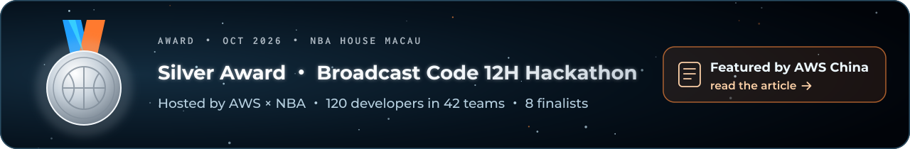
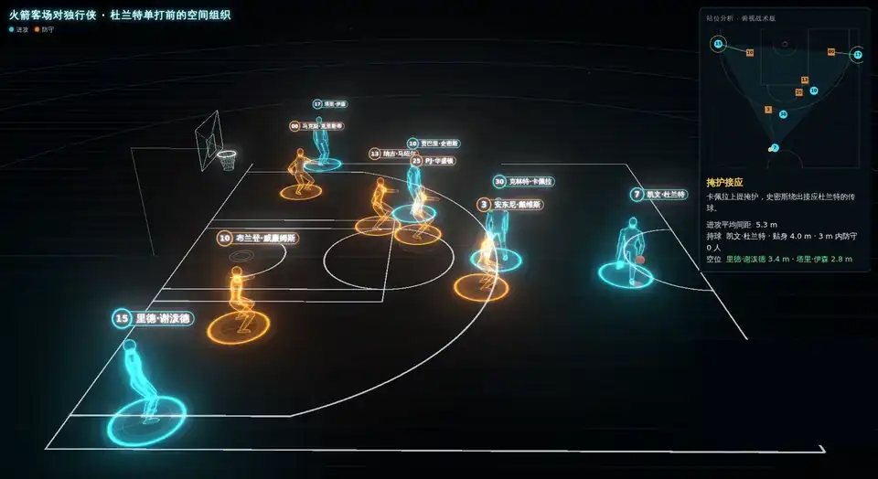

<div align="center">

<p></p>

<p>
<a href="https://mp.weixin.qq.com/s/hhVN8YK1eZvnQ_MH6_-vlg"></a>
<a href="LICENSE"></a>


<a href="https://github.com/jj-cheng25/AgentDunker2026/stargazers"></a>
</p>

**Give it a 5–20 s NBA broadcast possession; get back a narrated breakdown film with a ten-player holographic 3D tactical replay — fully automatic.**

[中文](README.md) · [Awards](#awards-and-press) · [Quick start](#quick-start) · [How it works](#how-it-works) · [Benchmark](#benchmark) · [Performance](docs/performance.md) · [Architecture](docs/architecture.md) · [Data contracts](docs/contracts.md) · [Configuration](docs/configuration.md)

</div>

<!-- DEMO-START -->
https://github.com/user-attachments/assets/daae0661-46ec-4bcc-ac1b-9dedd5bc3615

<p align="center">▶ <b><a href="https://github.com/jj-cheng25/AgentDunker2026/releases/tag/demo-durant">Watch the full 1080p film (GitHub Release: demo-durant)</a></b></p>
<!-- DEMO-END -->

## Awards and press

<a href="https://mp.weixin.qq.com/s/hhVN8YK1eZvnQ_MH6_-vlg"></a>

- **Silver Award** at the Broadcast Code 12H Hackathon hosted by AWS and the NBA (10–11 Oct 2026, Zhuhai and Macau, China). 120 developers formed 42 teams; the 8 finalists pitched at NBA House in Macau, and our team “爱看球的agent” won one of the three silver awards (1 gold, 3 silver, 4 bronze), presented by Krishna Bhagavathula, NBA EVP and CIO, among others.
- **Featured by AWS China's official WeChat account**: [“当120+名极客用AI给NBA‘做解说’，中国澳门的决赛现场燃炸了！”](https://mp.weixin.qq.com/s/hhVN8YK1eZvnQ_MH6_-vlg) (12 Oct 2026, in Chinese), in a section on our entry titled “an AI commentator with more emotion than a real fan”.
- The team comes from Shanghai Innovation Institute, Fudan University and the MOSS-VL video-understanding team at MOSI. AgentDunker started as our hackathon entry; this repository is the fully automatic, installable rewrite that followed.

## Highlights



**No manual steps**: detect and track the ten players and the referees, calibrate the court, read jersey numbers and
match the game, find the release and the ball path, render a 3D replay phase by phase, write and voice the
commentary, and cut it all into one film. When a step is unsure it degrades its element (fewer nameplates, no xFG
card, no 3D …) instead of failing the run; `report.json` gives every element a tier (A full / B degraded / C omitted)
and the reason.

## Holographic tactical replay



<p align="center"><sub>The 3D section of the demo film: ten holographic players, the tactical phase card, the top-down board and line-by-line subtitles (the broadcast picture-in-picture is masked; this repository contains no NBA footage)</sub></p>

## Quick start

```bash
git clone https://github.com/jj-cheng25/AgentDunker2026 && cd AgentDunker2026
python3 -m venv .venv && source .venv/bin/activate
pip install torch torchvision --index-url https://download.pytorch.org/whl/cpu   # CPU only; skip on a GPU machine
pip install -e .                      # one environment; extras: .[ui] .[gpu] .[dev]
agentdunker download-models           # weights + CLIP + Chromium ≈ 2.8 GB (sha256, resumable); pre-renders intro/outro
agentdunker doctor                    # checks every requirement
agentdunker run clip.mp4 -o out/      # → out/film.mp4 + out/report.json
```

**System requirements**: `ffmpeg` ≥ 6 with libx264, and Chromium's system libraries. On a fresh Ubuntu/Debian
server install them first: `sudo .venv/bin/playwright install-deps chromium` (`agentdunker doctor` starts Chromium
once and prints this command when libraries are missing). Disk: about 5.5 GB (virtual environment 2.4–3.1 GB,
weights and Chromium 2.8 GB).

<details>
<summary><b>Network in mainland China</b></summary>

<br>

```bash
# PyTorch CPU wheels from Aliyun (same sha256 as the official download.pytorch.org files, checked 2026-11-10)
pip install --timeout 60 -i https://mirrors.aliyun.com/pypi/simple/ \
    -f https://mirrors.aliyun.com/pytorch-wheels/cpu/ torch==2.15.0+cpu torchvision==0.29.2+cpu
pip install --timeout 60 -i https://mirrors.aliyun.com/pypi/simple/ -e .
# weights hosted on Hugging Face (CLIP, OSNet, court keypoints, ball detector) via the mirror; checksums unchanged
export HF_ENDPOINT=https://hf-mirror.com
agentdunker download-models
```

YOLO11 weights (GitHub Releases), fonts (GitHub) and Chromium (Playwright CDN) need access outside the mainland;
set `export https_proxy=http://<proxy>:<port>` if needed. If a download is cut, run `agentdunker download-models`
again: finished files are kept and partial ones resume.

</details>

<table>
<tr><th align="left">command</th><th align="left"></th></tr>
<tr><td><code>agentdunker run CLIP -o OUT [--preset fast|quality] [--threads N]</code></td><td>make the film, with per-step progress and timing; a re-run resumes from <code>OUT/work/</code></td></tr>
<tr><td><code>agentdunker doctor [--verify] [--ping]</code></td><td>Python packages, ffmpeg, Chromium, weights, API keys, official data; <code>--verify</code> checks weight sha256, <code>--ping</code> checks the API keys are accepted (free)</td></tr>
<tr><td><code>agentdunker download-models</code></td><td>weights, fonts, CLIP and Chromium, with source URL, sha256 and licence</td></tr>
<tr><td><code>agentdunker ui</code></td><td>local web page: upload, progress, preview, download (<code>pip install -e '.[ui]'</code>)</td></tr>
</table>

From Python: `from agentdunker import make_film; make_film("clip.mp4", "out/")`.

<details>
<summary><b>Model services (optional)</b>: Mosshub · MOSS · OpenAI-compatible · Gemini · fully offline</summary>

<br>

Defaults: Mosshub (gemini-3.8-flash, gpt-6-astra) and MOSS (TTS/ASR with the Mossland commentary voice, MOSS-VL):

```bash
export MOSSHUB_API_KEY=...   # jersey reading, role adjudication, commentary script, phase titles
export MOSS_API_KEY=...      # commentary voice + ASR read-back, MOSS-VL checks
```

OpenAI-compatible endpoints (including local vLLM / Ollama servers) and Google's Gemini API are supported too:
`agentdunker run clip.mp4 -o out/ --provider openai`; see [docs/configuration.md](docs/configuration.md).
`--offline` makes no model call at all: commentary becomes template subtitles and the VLM steps use local rules.

</details>

## How it works



Geometry is done by dedicated models; VLMs only make small, checkable judgements (read a number, read the score
bug, answer a multiple-choice check). Stages exchange only the JSON in [docs/contracts.md](docs/contracts.md)
(court coordinates in feet, origin at centre court). Audio first: once the lines are written, the 3D replay is
paced to them. Stages run in one process by default; `--isolate` runs each in its own subprocess. More in
[docs/architecture.md](docs/architecture.md).

## Benchmark



<details>
<summary>All numbers</summary>

<br>

| module | metric | result |
|---|---|---|
| tracking | player recall / precision / IDF1 / team accuracy (mean of 14 clips) | 0.920 / 0.98 / 0.847 / 0.978 |
| court | keypoint reprojection error median / p90 (9 clips, 169 points); frames calibrated | 5.5 px / 12.9 px; 95.4 % (100 % of court shots) |
| identity | jersey accuracy / misread rate; game match | 0.912 / 0.008; 10 of 10 correct, 0 wrong |
| events | shooter accuracy; release-time median error; make/miss | 85.7 %; 0.05 s; 14/14 |
| replay | ten players on court for the whole 3D window | c01, c14: 10/10 throughout, no jitter or teleports |
| narration | every line spoken inside its window; whole-track ASR read-back CER | yes; 0 % (reference, c02, c06) |

</details>

Numbers come from each module's acceptance record. The benchmark clips are NBA footage and are not part of this
repository.

**Performance**: runs on a 16-thread CPU with no GPU. On the 22 s c01 clip, `quality` with every service live takes
about 22 min (the voice stage is network-bound), about 11 min offline (the first film renders the intro/outro in the
background during the analysis, at no extra time); `--preset fast` offline about 8 min.
`--preset fast` uses a smaller detector (YOLO11m, detection at 10 Hz); everything else as `quality`. `--threads`
caps every stage. Stage times and what `fast` costs on the benchmark: [docs/performance.md](docs/performance.md).
The GPU is used automatically when present, but has not been benchmarked yet.

<details>
<summary><b>Known limitations</b></summary>

<br>

- Player names, official xFG and season stats need a local copy of the official data (`paths.nba_data`), which is
  not shipped. Without it plates show numbers (or nothing) and no xFG card is drawn; nothing is invented.
- Jersey numbers come from a VLM; unclear reads stay candidates (multi-frame vote + lineup constraint). Offline mode
  reads no numbers.
- The 3D replay needs ≥ 3 s of a calibrated wide shot; clips that are mostly close-ups skip it.
- Offensive possessions only; Chinese commentary only; the only voice is MOSS's Mossland voice (subtitles without a key).
- The 3D replay, intro, outro and transition are rendered with headless Chromium: without its system libraries
  those parts are skipped (`doctor` and the start of `run` print the fix). Chromium keeps Unix sockets in the temp
  dir, so a too-long `$TMPDIR` is replaced by `/tmp` automatically.
- Same-team occlusions still cause ID switches (IDF1 0.85); in 3D they show as short predicted stretches (`observed=false`).

</details>

## Licence

**AGPL-3.0** (Ultralytics YOLO11, BoT-SORT and the court keypoint model are AGPL-3.0). Every third-party
component, model, font, dataset and service is listed in [THIRD_PARTY_NOTICES.md](THIRD_PARTY_NOTICES.md).
**No NBA footage or official data is included** — never commit any. Contributing: [CONTRIBUTING.md](CONTRIBUTING.md).

## Acknowledgements



Shanghai Innovation Institute · Fudan University · MOSI. Model services by Mosshub and MOSS (TTS / ASR / MOSS-VL).
Built on Ultralytics, torchreid, OpenAI CLIP, DEIM, three.js, Google Fonts and many other open-source projects.
