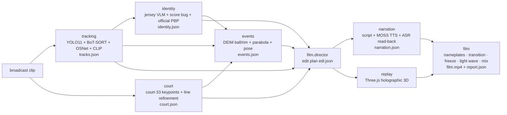

# AgentDunker

<!-- DEMO-START -->
https://github.com/user-attachments/assets/daae0661-46ec-4bcc-ac1b-9dedd5bc3615

▶ **[Watch the full 1080p film (GitHub Release: demo-durant)](https://github.com/jj-cheng25/AgentDunker2026/releases/tag/demo-durant)**
<!-- DEMO-END -->

**Give it a 5–20 s NBA broadcast possession; get back a narrated breakdown film with a ten-player holographic 3D tactical replay — fully automatic.**

[中文](README.md) · [Architecture](docs/architecture.md) · [Data contracts](docs/contracts.md) · [Configuration](docs/configuration.md) · [Performance](docs/performance.md)

## What it does

No manual steps: detect and track the ten players and the referees, calibrate the court, read jersey numbers and
match the game, find the release and the ball path, render a 3D replay phase by phase, write and voice Chinese
commentary, and cut it all into one film.

**Always a film, quality in tiers.** When a step is unsure it degrades its element (fewer nameplates, no xFG card,
no 3D …) instead of failing the run. `report.json` gives every element a tier (A full / B degraded / C omitted) and
the reason. It also works with **no API keys at all**: commentary becomes template subtitles and the VLM steps use
local rules.

## Quick start

```bash
git clone https://github.com/jj-cheng25/AgentDunker2026 && cd AgentDunker2026
python3 -m venv .venv && source .venv/bin/activate
pip install torch torchvision --index-url https://download.pytorch.org/whl/cpu   # CPU only; skip on a GPU machine
pip install -e .                      # one environment; extras: .[ui] .[gpu] .[dev]
agentdunker download-models           # ≈ 2.2 GB of weights (sha256-checked) + Chromium
agentdunker doctor                    # checks every requirement
agentdunker run clip.mp4 -o out/      # → out/film.mp4 + out/report.json
```

Needs `ffmpeg` ≥ 6 with libx264 on the PATH.

**Model services (optional).** Defaults: Mosshub (gemini-3.8-flash, gpt-6-astra) and MOSS (TTS/ASR with the
Mossland commentary voice, MOSS-VL):

```bash
export MOSSHUB_API_KEY=...   # jersey reading, role adjudication, commentary script, phase titles
export MOSS_API_KEY=...      # commentary voice + ASR read-back, MOSS-VL checks
```

OpenAI-compatible endpoints (including local vLLM / Ollama servers) and Google's Gemini API are supported too:
`agentdunker run clip.mp4 -o out/ --provider openai`; see [docs/configuration.md](docs/configuration.md).
`--offline` makes no model call at all.

| command | |
|---|---|
| `agentdunker run CLIP -o OUT [--preset fast\|quality] [--threads N]` | make the film, with per-step progress and timing; a re-run resumes from `OUT/work/` |
| `agentdunker doctor` | Python packages, ffmpeg, Chromium, weights, API keys, official data |
| `agentdunker download-models` | weights, fonts, CLIP and Chromium, with source URL, sha256 and licence |
| `agentdunker ui` | local web page: upload, progress, preview, download (`pip install -e '.[ui]'`) |

From Python: `from agentdunker import make_film; make_film("clip.mp4", "out/")`.

## Architecture



Geometry is done by dedicated models; VLMs only make small, checkable judgements (read a number, read the score
bug, answer a multiple-choice check). Stages exchange only the JSON in [docs/contracts.md](docs/contracts.md)
(court coordinates in feet, origin at centre court). Stages run in one process by default; `--isolate` runs each
in its own subprocess.

## Module metrics (14-clip hand-checked benchmark, 2026-10-27)

| module | metric | result |
|---|---|---|
| tracking | player recall / precision / IDF1 / team accuracy (mean of 14 clips) | 0.920 / 0.98 / 0.847 / 0.978 |
| court | keypoint reprojection error median / p90 (9 clips, 169 points); frames calibrated | 5.5 px / 12.9 px; 95.4 % (100 % of court shots) |
| identity | jersey accuracy / misread rate; game match | 0.912 / 0.008; 10 of 10 correct, 0 wrong |
| events | shooter accuracy; release-time median error; make/miss | 85.7 %; 0.05 s; 14/14 |
| replay | ten players on court for the whole 3D window | c01, c14: 10/10 throughout, no jitter or teleports |
| narration | every line spoken inside its window; whole-track ASR read-back CER | yes; 0 % (reference, c02, c06) |

The benchmark clips are NBA footage and are not part of this repository.

## Performance

End-to-end time of both presets on a 16-core CPU, and what `fast` costs on the benchmark:
[docs/performance.md](docs/performance.md). `--preset fast` uses a smaller detector (YOLO11m, 960 px, 10 Hz) and
skips the release pose; `--threads` caps every stage.

## Known limitations

- Player names, official xFG and season stats need a local copy of the official data (`paths.nba_data`), which is
  not shipped. Without it plates show numbers (or nothing) and no xFG card is drawn; nothing is invented.
- Jersey numbers come from a VLM; unclear reads stay candidates (multi-frame vote + lineup constraint). Offline mode
  reads no numbers.
- The 3D replay needs ≥ 3 s of a calibrated wide shot; clips that are mostly close-ups skip it.
- Offensive possessions only; Chinese commentary only; the only voice is MOSS's Mossland voice (subtitles without a key).
- CPU `quality` takes tens of minutes per 20 s clip (see the performance page). The GPU is used automatically when
  present, but the GPU path has not been benchmarked yet.
- Same-team occlusions still cause ID switches (IDF1 0.85); in 3D they show as short predicted stretches (`observed=false`).

## Licence

**AGPL-3.0** (Ultralytics YOLO11, BoT-SORT and the court keypoint model are AGPL-3.0). Every third-party
component, model, font, dataset and service is listed in [THIRD_PARTY_NOTICES.md](THIRD_PARTY_NOTICES.md).
**No NBA footage or official data is included** — never commit any.

## Acknowledgements

Shanghai Innovation Institute · Fudan University · MOSI. Model services by Mosshub and MOSS (TTS / ASR / MOSS-VL).
Built on Ultralytics, torchreid, OpenAI CLIP, DEIM, three.js, Google Fonts and many other open-source projects.

Contributing: [CONTRIBUTING.md](CONTRIBUTING.md).
